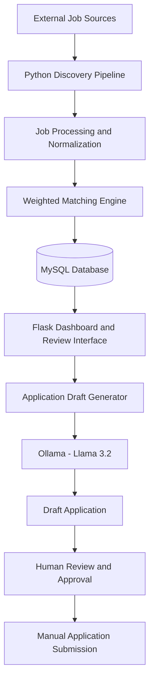

# AI Job Seeker
### Local-First AI Job Discovery, Matching & Human-Reviewed Application Workflow

AI Job Seeker is a personal AI-powered workflow automation project designed to streamline job discovery, evaluate job relevance, and prepare tailored application materials.

The system combines Python-based automation, weighted job matching, a relational database, workflow orchestration, and a locally hosted language model.

**Project status:** Active development — personal prototype, not yet a production SaaS deployment.

## 1. Problem Statement

Searching and applying for jobs across multiple platforms involves repetitive activities:

- Discovering relevant job opportunities.
- Reviewing job descriptions and requirements.
- Evaluating compatibility with professional skills and experience.
- Preparing tailored application materials.
- Organizing and tracking application progress.

This project aims to reduce repetitive work through an integrated AI-assisted workflow while retaining human oversight over application decisions.

## 2. Core Capabilities

### Job Discovery
Automated job discovery from external job platforms and public job sources.

The discovery pipeline has been tested with sources including RemoteOK, Remotive, Himalayas, Arbeitnow, and We Work Remotely. Source availability depends on external API and website conditions.

### Weighted Job Matching

A transparent scoring model evaluates job relevance using three dimensions:

| Matching Dimension | Weight |
|---|---:|
| Role relevance | 40% |
| Skills compatibility | 35% |
| Location eligibility | 25% |

The scoring process helps prioritize opportunities based on professional requirements and location preferences.

### AI-Assisted Application Drafting

The system uses Ollama with the Llama 3.2 model to generate draft application materials, including tailored cover letters.

Generated content is intended for user review and editing before use.

### Application Management

Application records and workflow states are stored in MySQL.

The system supports a human-review workflow. Generated application drafts can be saved with a `pending_approval` status.

**The current implementation does not autonomously submit applications without user approval.**

## 3. System Architecture



## 4. Technology Stack

| Component | Technology |
|---|---|
| Programming language | Python |
| Database | MySQL |
| Local language model | Ollama / Llama 3.2 |
| Dashboard and API | Flask |
| Workflow automation | n8n |
| Container environment | Docker |
| Job matching | Weighted scoring algorithm |
| Development environment | Windows |

## 5. My Engineering Contributions

I designed and developed this project as a personal engineering initiative.

My contributions include:

- Designing the overall workflow and component architecture.
- Developing Python-based job discovery and processing scripts.
- Implementing weighted job relevance scoring.
- Integrating a locally hosted LLM through Ollama.
- Building database-backed application management.
- Developing a human-review application workflow.
- Configuring local infrastructure using Docker, MySQL, and n8n.
- Troubleshooting external source failures and local integration issues.

The project is intended to demonstrate practical skills in Python development, AI integration, workflow automation, database engineering, and system integration.

## 6. Reliability, Human Oversight and Limitations

The project is still under active development.

Current design considerations include:

- Human approval before application submission.
- Transparent, configurable job matching weights.
- Awareness of external data-source failures and availability limitations.
- Local-first execution to retain control over application data.
- Review of generated application content before external use.

Known limitations:

- External job sources can change their APIs, access policies, or website structure.
- Some sources have experienced access errors, including HTTP 403 responses.
- Job matching scores are ranking indicators, not guarantees of job suitability.
- AI-generated application materials require human verification.
- The system has not yet undergone independent production-scale reliability or performance testing.

## 7. Current Development Direction

Planned improvements include:

- Improving source reliability and error handling.
- Strengthening job deduplication and data validation.
- Improving location and work-eligibility classification.
- Expanding workflow observability and evaluation.
- Improving dashboard review and application management.
- Preparing a more comprehensive automated testing strategy.

## 8. Project Philosophy

The objective is not to replace human judgment.

It is to build practical AI systems that reduce repetitive work, integrate multiple services, provide explainable outputs, and preserve meaningful human control over consequential actions.

---

**Developer:** Claud
**GitHub:** https://github.com/6Nimzo9
**Project:** AI Job Seeker

## Engineering Documentation

- [Engineering Case Study](docs/ENGINEERING_CASE_STUDY.md)
- [Architecture, Guardrails, and Evaluation](docs/ARCHITECTURE_AND_EVALUATION.md)

## Automated Tests

The repository includes 32 automated unit tests covering application workflow controls, query safety, job-source behavior, and eligibility checks.

Run the suite with:

```powershell
python -m unittest discover -s tests -v
```

**Latest local validation:** 32 tests passed on November 15, 2026. The suite uses simulated database behavior and controlled failure scenarios; this is not a production-scale reliability claim.
