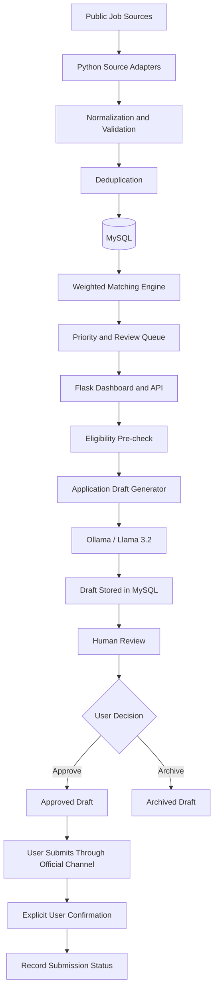

# Architecture, Guardrails, and Evaluation

## 1. Architecture Overview



The design separates collection, matching, eligibility review, content generation, and application-state management. n8n is used for local workflow orchestration; Python modules perform the core discovery and processing tasks.

## 2. Component Responsibilities

| Component | Responsibility |
|---|---|
| `discover_jobs.py` | Coordinates job discovery and collection |
| `sources/` | Source-specific job listing adapters |
| `company_board_sources.py` | Company-board integrations |
| `location_rules.py` | Location interpretation and classification |
| `score_jobs_v2.py` | Weighted job matching |
| `priority_queue.py` | Prioritization and review queue logic |
| `shortlist_jobs.py` | Shortlist processing |
| `application_eligibility_precheck.py` | Eligibility-related checks |
| `application_generator.py` | AI-assisted application drafting |
| `prepare_application_packet_checked.py` | Guarded application-packet preparation |
| `db.py` | MySQL connection integration |
| `profile_settings.py` | Profile settings persistence |
| `app.py` / `api.py` | Flask dashboard and API |
| `templates/` / `static/` | Dashboard presentation layer |

## 3. Matching and Prioritization

The configured scoring weights are:

- Role relevance: 40%.
- Skills compatibility: 35%.
- Location compatibility: 25%.

The score is intended to rank opportunities for review. It does not establish legal eligibility, work authorization, or employer-specific hiring policy.

Location information may be incomplete, ambiguous, or stale. A location label is therefore treated as a signal requiring interpretation, not as proof that an applicant can legally work in that location.

## 4. Human-in-the-Loop Controls

The application workflow separates internal review from external submission.

| Action | System behavior |
|---|---|
| Generate draft | Creates draft content for user review |
| Approve | Changes the internal review status |
| Archive | Retains the record with archived status |
| Record submission | Requires approved status and explicit user confirmation |

The dashboard does not independently submit applications. The user remains responsible for reviewing generated content, verifying employer requirements, submitting through the official channel, and confirming the outcome.

## 5. Security Controls

The application review implementation includes:

- Session-bound CSRF tokens.
- Constant-time CSRF token comparison.
- Parameterized SQL.
- Profile-scoped application operations.
- Explicit validation of permitted status transitions.
- Duplicate submission timestamp rejection.
- Human confirmation before a submission is recorded.

The repository is intended to exclude runtime credentials, OAuth tokens, personal CV files, local databases, application packets, logs, and local runtime configuration.

The dashboard is intended for local use. Any public deployment would require a separate authentication, authorization, infrastructure, and security review.

## 6. External Dependency and Failure Handling

External job sources are independent systems and may become unavailable or change their response formats.

Conditions covered by the current tests include:

- API request failures.
- HTTP 403 access responses.
- Incomplete or uncertain location information.
- Expired or unknown application deadlines.
- Listings that are closed or whose country eligibility is unconfirmed.

Eligibility tests verify that uncertain or disqualifying conditions can block packet preparation or require manual review.

A source failure is not proof that a job is invalid. Missing eligibility evidence is not treated as confirmation.

## 7. Operational Visibility

The project includes local dashboard and database components intended to make discovery and application state inspectable.

Recorded source-run information includes operational fields such as fetched counts, unique listing counts, inserted records, duplicate counts, invalid URLs, execution duration, timestamps, and error messages where available.

This is local operational visibility, not a fully managed monitoring platform. The project does not claim production alerting, distributed tracing, or service-level objectives.

## 8. Test Strategy

Run the automated suite from the repository root:

```powershell
python -m unittest discover -s tests -v
```

The current suite contains 32 tests:

| Test module | Coverage |
|---|---|
| `test_application_actions_route.py` | Approval, archive, CSRF, submission confirmation |
| `test_application_query.py` | Profile scoping, rendering, parameterized filtering, state transitions |
| `test_himalayas_search_expansion_v2.py` | Search expansion, pagination, deduplication, API failure handling |
| `test_prepare_application_packet_checked.py` | Expiry, closed listings, country confirmation, work-rights checks, manual review |
| `test_query_builder.py` | Combined filters, SQL parameterization, sorting |

**Latest local result:** 32 tests passed on November 15, 2026.

The suite uses fake database components and controlled failure scenarios. It is an automated unit-test suite, not an end-to-end production environment test.

## 9. Known Limitations

- External source availability and data quality are not guaranteed.
- Location and eligibility classifications may require manual verification.
- AI-generated application content may contain errors and must be reviewed.
- Production-scale load, uptime, and security certification have not been completed.
- No measured hiring outcome or independent productivity benchmark is claimed.

## 10. Next Engineering Improvements

- Expand tests for source adapters and data normalization.
- Evaluate matching precision and false-positive rates against a reviewed sample.
- Improve reproducible local deployment and configuration validation.
- Expand operational metrics and failure reporting.
- Improve eligibility evidence and manual-review explanations.